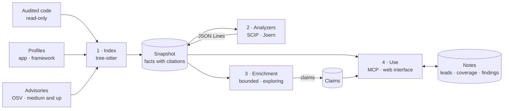
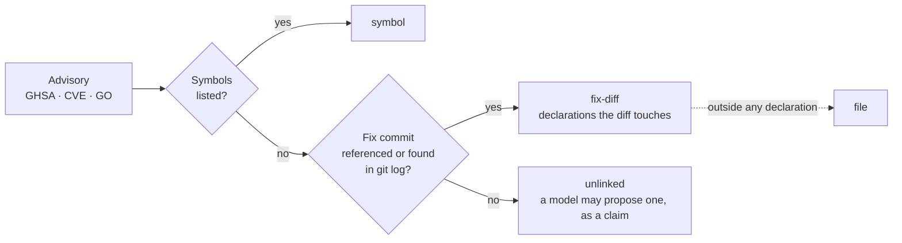
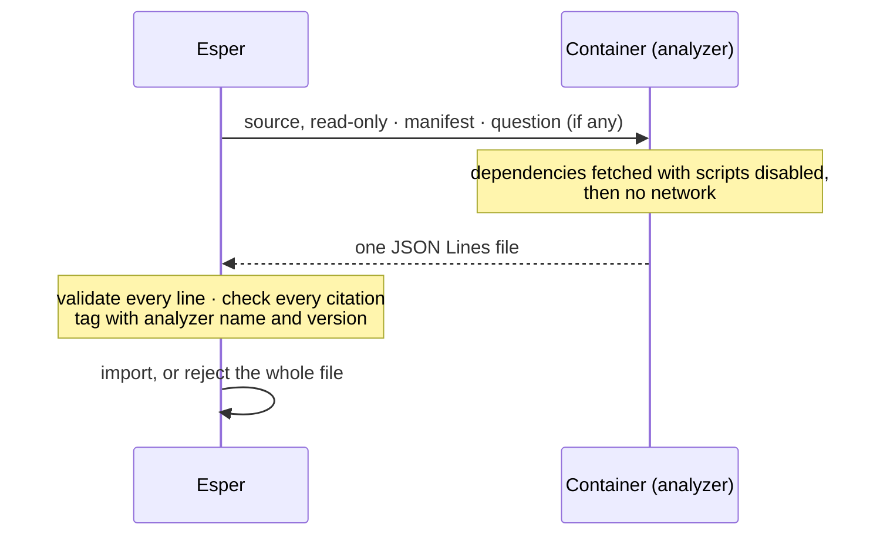
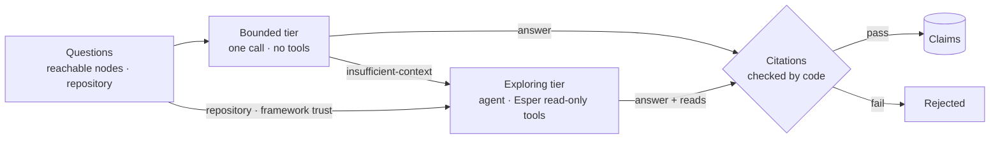
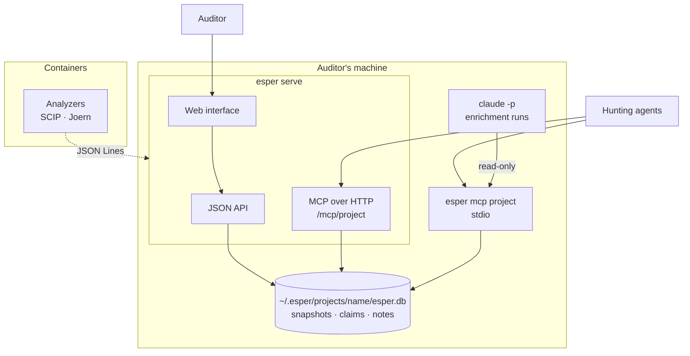
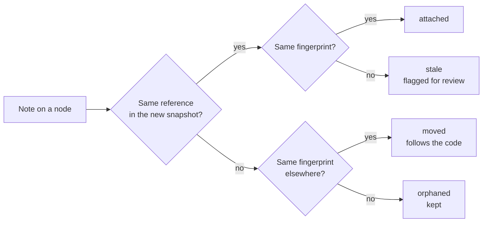

This page describes Esper as built, following the [decisions](/decisions/): each step links to the
decision behind it. Dataflow (Joern) is the one part not built yet, and says so
([roadmap](/roadmap/#m9--dataflow-on-demand)).

## The whole path



Four steps, each with its own rule. The **index** produces facts from the code, and nothing else.
**Analyzers** add precision from outside the process. **Enrichment** adds a model's claims beside
the facts, never among them. **Use** is where agents and the auditor read all of it and write notes.
Facts can be rebuilt from the code, claims from a model run; notes cannot be rebuilt, so nothing in
the path ever drops one.

## A walkthrough

Auditing Hono, from its repository to a first finding:

```sh
esper add https://github.com/honojs/hono   # a project, cloned into Esper's home
esper index hono --ref v4.6.0              # a snapshot of that version
esper serve                                # the web interface, the API and MCP
esper mcp hono                             # what a hunting agent connects to
```

Hono is recognised as a framework, so its entry points are its request surface rather than routes
([D5](/decisions/#d5--two-kinds-of-target-applications-and-the-frameworks-themselves)). An agent asks
for the entry points that read a header and reach a short-circuit, follows the path from one of them
to the code that decides, writes a `lead` on it, and later a `coverage` note on the slice it has
ruled out. If a later version fixes what the lead points at, indexing it (`--ref` with its tag) adds a
second snapshot: notes on unchanged nodes carry over, the note on the fixed function is marked
`stale`, and `esper_diff` compares the two snapshots.

The index also links Hono's past advisories to the code their fixes touched
([D19](/decisions/#d19--past-vulnerabilities-advisories-linked-to-the-code-they-touched)): the entry
points that reach one carry the `fix-downstream` signal, and the agent can start from them, looking
for a variant or a bypass of the fix.

## 1 · Index

Parsing only, without a model, without running anything
([D11](/decisions/#d11--indexing-rules)).

1. **List the files.** The snapshot's files are listed; tests, examples, fixtures and vendored code
   are skipped, and every skipped folder is recorded.
2. **Pick the profile.** The profiles say which framework the target uses, and whether the target is
   an application built on it or the framework itself. No matching profile, or no supported
   language: the index refuses, with the reason, rather than return an empty attack surface.
3. **Parse.** Each file goes through tree-sitter ([D3](/decisions/#d3--one-parser-tree-sitter-in-webassembly)).
   The language's queries extract declarations, imports and calls; the profile's rules extract entry
   points, chains, reads, guards, data writes and sinks
   ([D10](/decisions/#d10--frameworks-as-profiles)).
4. **Resolve.** Imports are resolved through the target's own aliases. Each call edge is `resolved`
   when one declaration matches, or `guessed`, with its reason, when the index can only name a
   candidate.
5. **Name and fingerprint.** Every node gets its stable reference and a fingerprint of its code
   ([D7](/decisions/#d7--stable-references-and-fingerprints)).
6. **Compute signals.** From the facts, by rules: `data-write`, `request-key`, `divergent-guard`
   between sibling routes, and the rest of the closed vocabulary
   ([D6](/decisions/#d6--the-graph-model)).
7. **Link past advisories.** The target's advisories of medium severity or more are fetched from
   OSV and linked to the declarations they concern, each link with its precision
   ([D19](/decisions/#d19--past-vulnerabilities-advisories-linked-to-the-code-they-touched)). They
   belong to the project: each snapshot, when it is read, places them on its code and gives
   `fix-downstream` to the entry points that reach one
   ([D30](/decisions/#d30--advisories-belong-to-the-project-and-are-placed-on-each-snapshot)).

How an advisory is linked:



Every fact is stored with its citation (`file:line`) and its source. A reindex reads the whole
target, and a commit already indexed with the same profiles is not indexed again
([D20](/decisions/#d20--a-reindex-reads-the-whole-target)); the same code with the same profiles
gives the same snapshot.

## 2 · Analyzers

What tree-sitter cannot see, an analyzer adds, from a container and through one contract
([D12](/decisions/#d12--precision-scip-right-after-the-first-index-dataflow-later)).



- **SCIP**, right after the first index of a language, runs the language's type-checker and turns
  guessed call edges into resolved ones. It runs inside the index when asked
  (`esper index --precise`), so that entry points follow the resolved edges
  ([D22](/decisions/#d22--precision-runs-inside-the-index-when-asked),
  [analyzers](/reference/analyzers/)).
- **Joern** (or CodeQL), on demand, not built yet ([M9](/roadmap/#m9--dataflow-on-demand)), answers a dataflow question (does this read reach this sink) and
  adds `flows` edges with each step cited. A question is asked through MCP (`esper_flow_request`) or
  the interface.

An analyzer reads code and writes a file; it never sees the database.

## 3 · Enrichment

A model answers closed questions on the nodes reachable from an entry point, and a few on the whole
repository. Its answers are **claims**, stored apart from the facts
([D17](/decisions/#d17--model-enrichment-claims-beside-the-facts),
[claims](/reference/claims/)).



- **Bounded tier.** One call per batch of nodes, with no tools: the question carries the node's code
  and the signatures it calls.
- **Exploring tier.** An agent reads what it needs through Esper's read-only MCP tools (`esper_search`,
  `esper_node`, `esper_callers`, `esper_callees`, `esper_paths`, `esper_read`), confined to the snapshot,
  with every read logged.
- **Checks.** Each citation must point to an existing line that contains the identifier the claim
  names. A claim records the fingerprints of every node it rests on, and is asked again only when
  one of them changes.

By default the model is reached through the auditor's own Claude Code (`claude -p`, on their plan),
started from Esper's home and given only what its tier needs; an API key is the other provider.
A claim is shown as *claimed by a model*, never sets a signal on its own, and the index works without
any.

## 4 · Use



- **Agents** connect over MCP, to one project per connection
  ([D18](/decisions/#d18--running-esper-one-home-many-projects)). They list entry points by guard,
  read or signal, follow callers, callees and paths, read a node with its code, facts and notes,
  ask for its claims apart, and write notes. Every answer is bounded and says when it was cut; a
  read-only connection writes nothing ([D13](/decisions/#d13--the-mcp-surface)).
- **The auditor** uses the [web interface](/reference/interface/): routes grouped by chain, read or
  signal; a map of the code a group of routes shares; a bounded subgraph from an entry point to
  what it reaches, with the code beside it; claims marked as such; notes where they sit
  ([D14](/decisions/#d14--one-server-for-the-api-mcp-and-the-web-interface)).
- **Every writer shares a project's database**, in write-ahead logging mode
  ([D9](/decisions/#d9--storage-one-sqlite-database-per-project-outside-the-target)). The server
  watches it, so an agent's note shows in the interface as soon as it is written, through the
  server or `esper mcp` in another process
  ([D28](/decisions/#d28--the-server-a-token-kept-in-the-home-events-from-the-database)).

## Notes across versions

A note is attached to a node's reference, with the fingerprint the node had when the note was
written ([D8](/decisions/#d8--notes)). Each new snapshot checks every anchor
([Notes](/reference/notes/#anchors-after-a-reindex)):



Claims follow the same fingerprints, so the model is asked again only about code that changed.
Edits and deletions of notes are kept as revisions, so the auditor can see what an agent changed.

## What runs where

| Component | Runs | Reads | Writes |
|---|---|---|---|
| Indexer | in Esper's process | the target's files, and its git history for fix commits | the snapshot |
| Advisory import | in Esper's process, the one network call (`--offline` turns it off) | OSV, and the target's git history | advisories and their links, placed on each snapshot as `advisory` nodes and `affects` edges |
| Analyzers | in a container | the target's files, mounted read-only | one JSON Lines file |
| Enrichment, bounded | `claude -p` or the API, no tools | the question it is given | its answer |
| Enrichment, exploring | `claude -p` or the API, Esper's read-only tools | the snapshot, through Esper | its answer |
| MCP and API | in Esper's process | the project's database | notes, claims, requests |
| Web interface | in the browser | the API | notes, through the API |

The target is never built, run or written to; its code is data for every component that reads it.
