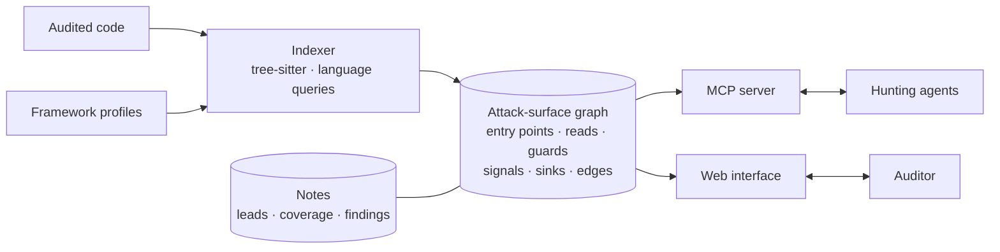

import { Card, CardGrid } from '@astrojs/starlight/components';

<p class="esper-lede">
	Esper is at the design stage: this page describes what it is meant to be, not what it does
	today.
</p>

## The problem

Code graphs answer **who calls what**. An auditor, human or agent, asks something else: **how
does an attacker's request enter the code, and where does it go?** Which routes exist, what each
one reads from the request, which checks stand in front of it, and whether it reaches a write or a
sink.

Without that map, an agent hunting for vulnerabilities starts from raw files. It spends its context
finding routes instead of questioning them, misses the one route that lacks the guard its
siblings have, and forgets what it has already ruled out as soon as its context is summarised.

## What the graph carries

The call graph is the substrate. What makes it useful for an audit is what Esper puts on it, all
computed by parsing, without a model:

| On the graph | What it says |
|---|---|
| **Entry points** | for an application, a route: method, path, the middleware chain in front of the handler; for a framework, an exported symbol that reads the request |
| **Reads** | what the handler takes from the request: `header`, `query`, `path`, `body`, `cookie`, `form`, `host`… |
| **Guards** | the checks on each route's path, so that a route missing a guard its siblings have stands out |
| **Signals** | what the code does with the request: writes persisted data, takes an object key from the client, spreads input into an object, short-circuits the stack, hands request state to code that can write to it |
| **Sinks** | per language and per framework: interpreting, opening a resource, starting a process; and templates that render content unescaped |
| **Edges** | each call edge is **resolved** or **guessed**, with its reason |
| **References** | a stable `file#symbol` identity that findings cite and that survives reindexing |

A route, as an agent would receive it (illustrative; the format is not settled):

```yaml
e-0042: POST /api/projects/[id]/members        # src/routes/api/projects/[id]/members/+server.ts:12
  chain:   [handle, requireUser]               # no requireOwner, unlike its 4 sibling routes
  reads:   [path.id, body]
  signals: [data-write, request-key, divergent-guard]
  reaches: db.insert (resolved) · sendInvite (guessed: untyped receiver)
```

A signal is not a defect. It says where to look, and the code answers.

## Notes are the audit

What an audit learns belongs on the graph, next to the code it is about. Agents and humans create,
edit and delete notes on any node: a route, a symbol, an edge.

- **Leads**: a hypothesis on a route, with the `file:line` it cites.
- **Coverage**: this slice was hunted from this angle, and nothing came out. What has been ruled
  out is written down, so the next agent does not redo it.
- **Findings**: a confirmed issue attached to the code it lives in, and the path that reaches it.

A note is attached to a stable reference. When the code is reindexed, a note on an unchanged node
carries over; a note on a changed node is flagged for review rather than silently kept.

## How it is used

<CardGrid>
	<Card title="An index, not a model" icon="seti:graphql">
		tree-sitter parses every language into one graph format. Languages are extraction queries,
		frameworks are profiles. Nothing in the graph is a model's opinion.
	</Card>
	<Card title="Served over MCP" icon="rocket">
		Hunting agents query bounded tools: entry points, callers, callees, the paths from a route to
		a sink, and the notes on any node. They read and write notes through the same server.
	</Card>
	<Card title="A web interface" icon="laptop">
		Explore the attack surface: routes grouped by chain and signal, a path from an entry point to a
		sink, the code beside the graph, and the notes where they sit.
	</Card>
	<Card title="The code is data" icon="warning">
		The audited project is read, never built or run. What its comments and instruction files ask
		does not apply to anything that reads the graph.
	</Card>
</CardGrid>



## Principles

- **Computed, not guessed.** When an edge cannot be resolved (a method on an untyped receiver, an
  interface, a name shared by two declarations), it is kept but marked as guessed, with its reason.
  A guessed edge only says it is the one callee the index can name.
- **Refuse rather than return nothing.** A target the index cannot read, an unsupported language or a
  framework without a profile, is refused. An empty list would pass for an empty attack surface.
- **Bounded answers.** A query returns a sized result, not a dump, so an agent can afford to ask.
- **Frameworks as data.** How a framework declares a route, what it reads, what refuses a request:
  that lives in a profile. Adding a framework adds no branch to the indexer.
