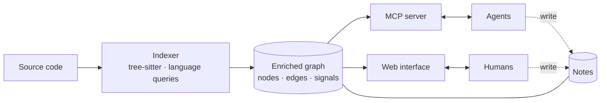

import { Card, CardGrid } from '@astrojs/starlight/components';

	Esper is at the design stage: this page describes what it is meant to be, not what it does
	today. It grows out of the code indexer of <a href="https://github.com/JoshuaMart/Forge">Forge</a>,
	extracted into a tool of its own.

## The problem

An agent that works on a codebase starts from raw files. To learn who calls a function, or how a
request reaches a database write, it greps, reads, and guesses. It spends most of its context on
finding its way around rather than on the question it was asked. And what it learns is lost when
the session ends or the context is summarised: the next agent, or the human after it, starts over.

Two things are missing: a **map** of the code that is computed rather than guessed, and a **place
to write down** what has been understood about it.

## The idea

**Code builds the graph. Agents and humans annotate it.**

<CardGrid>
	<Card title="An enriched graph" icon="seti:graphql">
		Parsed with tree-sitter, across languages: declarations, imports, call edges and entry
		points, plus signals computed from the code, such as a route that writes data or a function
		that reaches a sink. No model is involved in building it.
	</Card>
	<Card title="Notes on the graph" icon="pencil">
		Create, edit and delete notes attached to a node: a file, a symbol, an edge. Notes are what
		has been understood, so they outlive a session and are shared by whoever reads the graph next.
	</Card>
	<Card title="Served over MCP" icon="rocket">
		Agents query the graph through bounded tools, like callers, callees, paths and context, and
		read or write notes through the same server.
	</Card>
	<Card title="A web interface" icon="laptop">
		Explore a project visually: zoom from modules to symbols, follow a call path, and read or
		edit the notes where they sit.
	</Card>
</CardGrid>

## Principles

These come from building the indexer in Forge, where they were paid for.

- **Computed, not guessed.** The graph comes from parsing. When an edge cannot be resolved (a
  method on an untyped receiver, an interface, a name shared by two declarations), it is kept but
  marked as **guessed**, with its reason. A guessed edge only says it is the one callee the index
  can name.
- **Stable identifiers.** A node keeps its identifier across reindexing as long as it has not
  changed, so the notes attached to it survive a new version of the code.
- **The code is data.** The indexed project is read, never built or run. What its comments and
  instruction files ask does not apply to anything that reads the graph.
- **Bounded answers.** A query returns a sized result, not a dump, so an agent can afford to ask.
- **Languages and frameworks as data.** What is specific to a language lives in its extraction
  queries, and what is specific to a framework, like how a route is declared, lives in a profile.
  Adding one adds no branch to the indexer.
